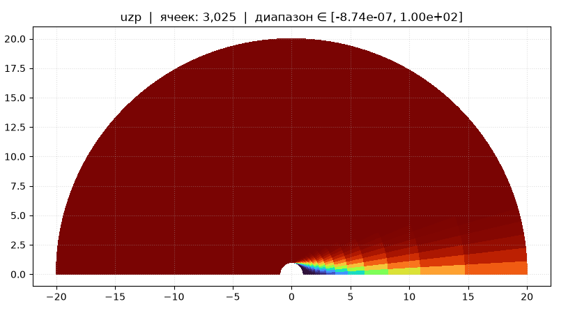
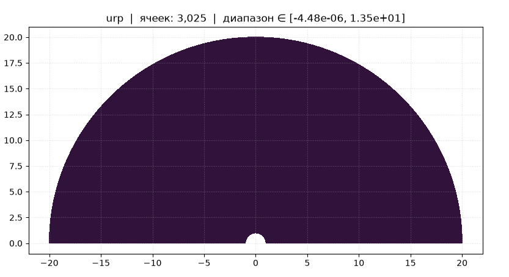
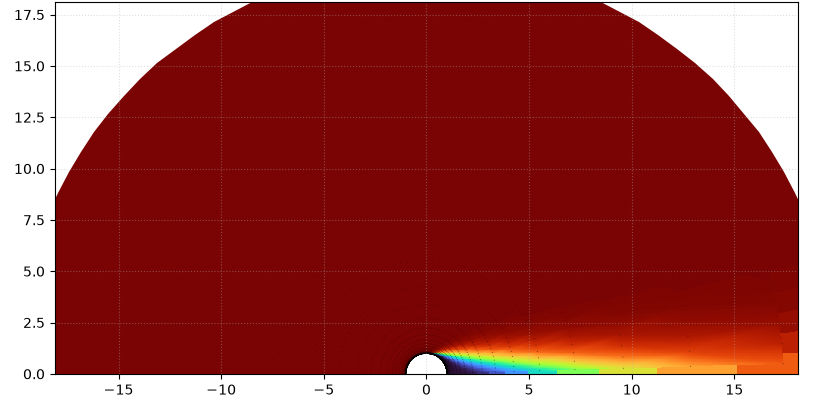
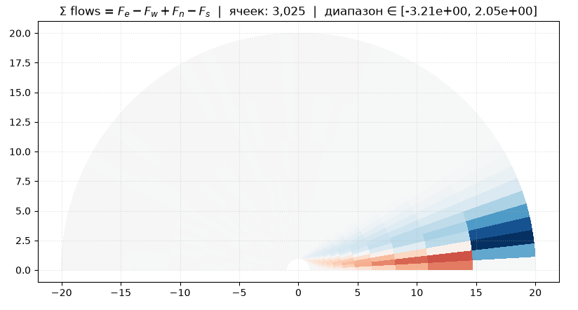
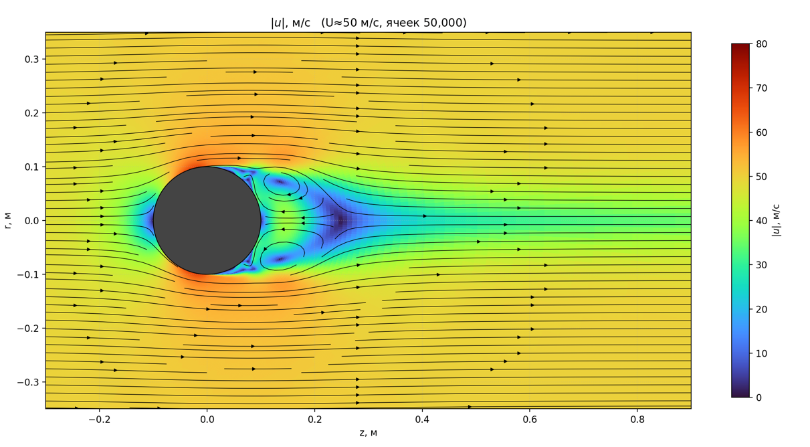
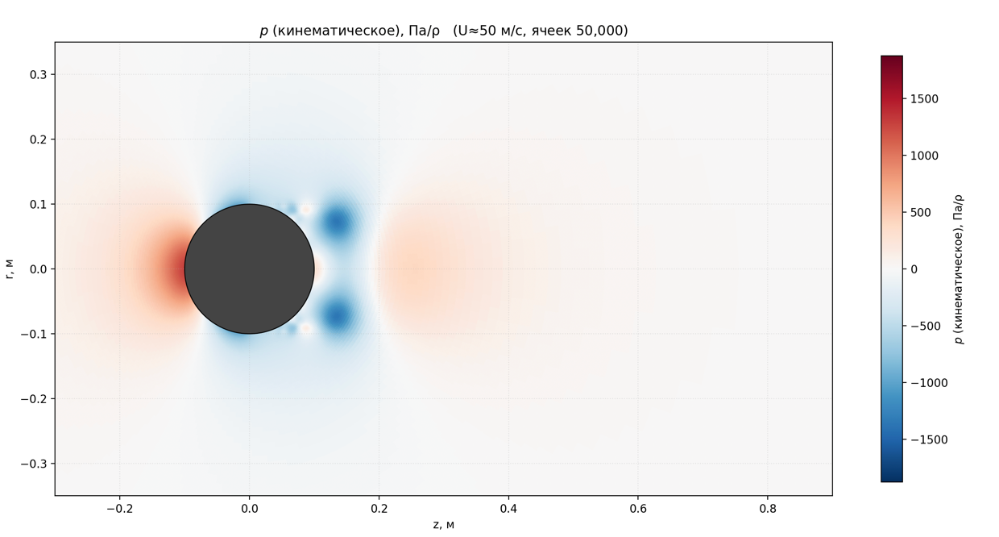
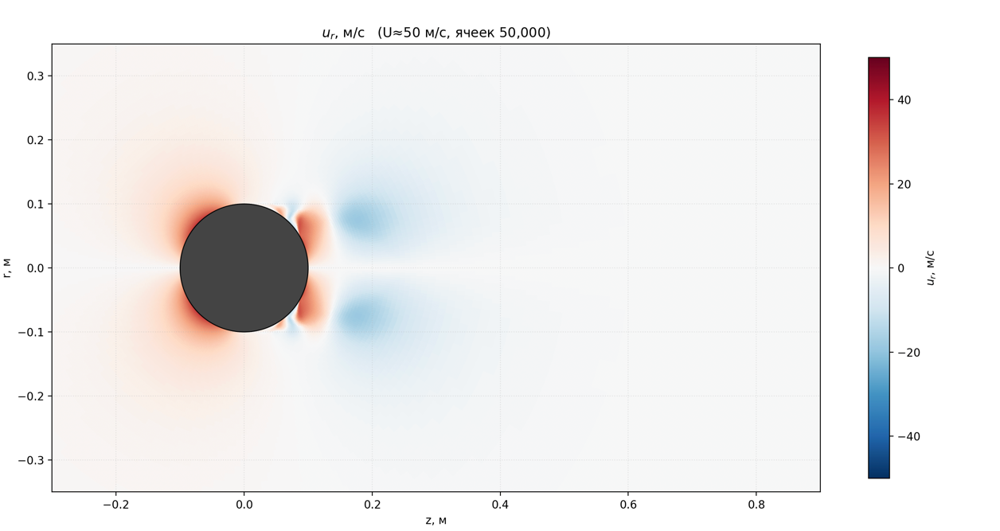
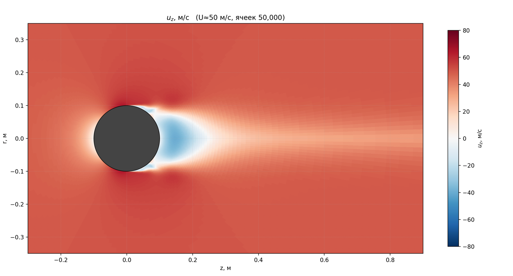
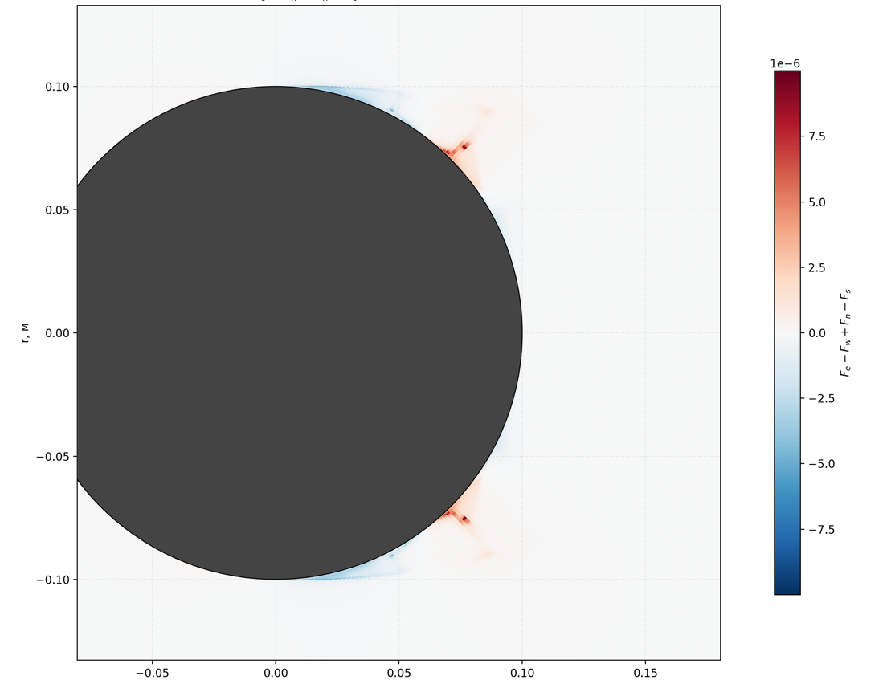

# Численное моделирование обтекания шара воздухом в закритическом режиме.

Данный проект посвящён численному моделированию поведения воздуха вокруг шара, при турбулентном обтекании воздухом шара
предполагается, что в рамках моделирование число Рейнольдса находится в закритической зоне. $Re > 10^5$

## Авторство
- Метельский Артем, студент группы 4385
- Алейников Иван, студент группы 4385


##  Запуск программы
```shell
./build.sh
```

Для полученного исполняемого файла программа запускается следующим образом
```shell
./NS -s [скорость в м/с] -r [радиус в м] -d [разрешение сетки [0, 1] ]
```

Программа выдается данные в текстовом формате  в консоль. 

В дальнейшем предполагается, что данные нужно визуализировать, в эом случае вывод программы 
перенаправляется в файл, который потом передается в программу визуализатор. 

На текущий момент визуализатор написан ИИ. В скором будущем он будет переписан, и будет использоваться
сторонняя программа для визуализации. При помощи формата данных `*.vtk`

```shell
python3 ai_slop_visualizer.py [file.txt]  [-h] [--field {mag,uz,ur,p,flow}] [--all] [--xlim XLIM XLIM] [--ylim YLIM] [--arrows ARROWS ARROWS] [--normalize] [--stream] [--density DENSITY]
               [--stream-on-all] [--units] [--fig-w FIG_W] [--fig-h FIG_H] [--out OUT] [--dpi DPI] [--no-show]
```

Для того, чтобы посчитать коэффициент лобового сопротивления необходимо запустить следующий скрипт, передав текстовый файл
и скорость симуляции

```shell
python3 get_cda.py [file.txt] --U [Скорость в симуляции]
```


## Примеры для визуализации

Поскольку программа пока что находится в стадии проектирования
иногда запускаются странные, случайные симуляции, в которых получаются интересные результаты.

В рамках этого раздела все эти примеры собраны, и объяснено что в каждом из них особенного находит автор.

1) `examples/example_01.txt` - пример симуляции на скорости $0.0073$ м/c. Решение некорректно. $Re = 10$ но, карта давлений неверна, 
коэфициент лобового сопротивления неверно. Но картинка интересная.
2) Класс примеров, который характеризует формирование потоков. В рамках этого примера
скорость набегающего потока равняется 50 м/c. `examples/example_02.txt` - сетка высокого разрешения,
но всего 20 внешних итерацийЮ давление уже почти сошлось, но, срыв потока еше не сформировался
`examples/example_03.txt` - та же самая сетка, но количество итераций равняется 500. Поток начал срываться, но
очень поздно, Cda  начал расти, давления меняются, но срыв потока еше не сформировался. 
`examples/example_04.txt` - те же самые параметры, но прошло 2000 итераций, решение сошлось, срыв потока находится в правильном месте
, CdA корректен, но на просчет этого случая прошло 8 часов.
3) `examples/example_05.txt` Скорость набегающего потока $50 м/c$, грубая сетка на 3000 ячеек. Результат спустя 500 итераций. Срыв сформировался верно, CdA корректен. Пример был сделан для того чтобы проверить, что численная схема корректна на любых разрешения сетки. Но, можно сдлеать вывод, что чем сетка гуще, тем больше итераций для того чтобы решение сошлось нужно.
4) `examples/example_06.txt` - Скорость набегающего потока $100м/c$, грубая сетка, малое количество итераций, но решение сошлось.
5) `examples/example_07.txt` - Скорость набегающего потока $50м/c$ грубая сетка, 20 итераций. Решение не сошлось, срыв потока
только начал образовываться.

### Интересные наблюдения
Если построить карты давление, на сошедшихся решениях при скорость набегающего потока, можно заметить, что зона пониженного давления
разделяется на две подзоны, одна прямо на "полюсе" шара, другая же позади нее. Что интересно -- та зона, что нахоидтся 
позади, давление в ее центре больше чем давление на полюсе. Стоит отметить что разделение давления подобным образом -- норма, не норма то, что оно ниже чем на полюсе. Но, это исправится при добавлении модели SA. При добавлении нее динамическая
вязкость будет влиять на вихрь, и давшение в центре него вырастет относительно давление на полюсе.


## Текущий прогресс
*07.11.2026*

Подсчет компонент скорости
    - Z компонета вектора скорости
   
*08.11.2026*

R компонента вектора скорости
   
    - Итоговая картина
   
Подсчет потоков


*11.11.2026*
- Добавлен подсчет давления
- Добавлен общий цикл всего метода подсчета потоков, связи скоростей, давлений, потоков.
- Исправлена сходимость алгоритма
- Проведено тестирование.



*Поле скоростей вокруг шара*



*Поле давлений вокруг шара*



*Поле r компоненты скорости вокруг шара*


*Поле z компоненты скорости вокруг шара*


*Поле потоков  вокруг шара*


