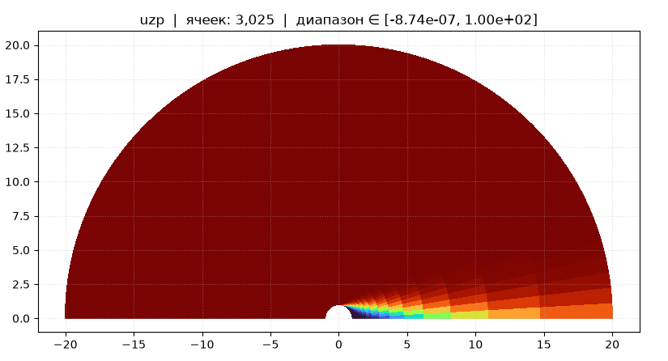
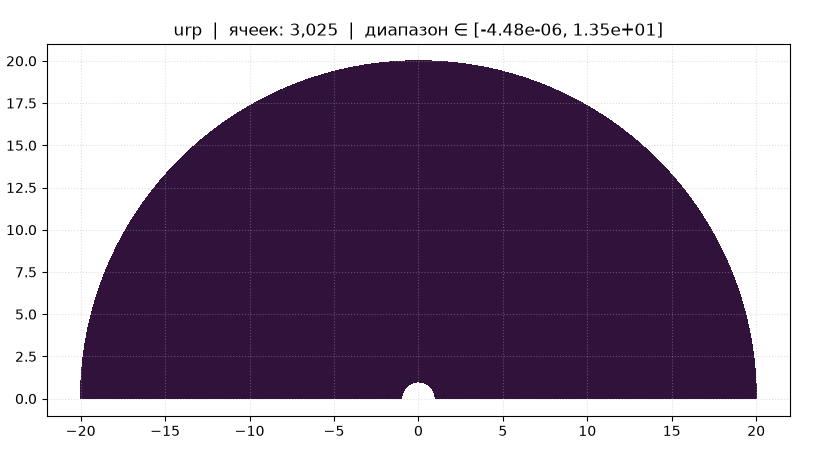
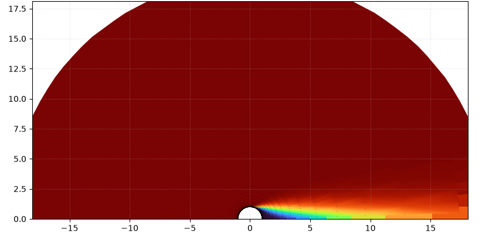
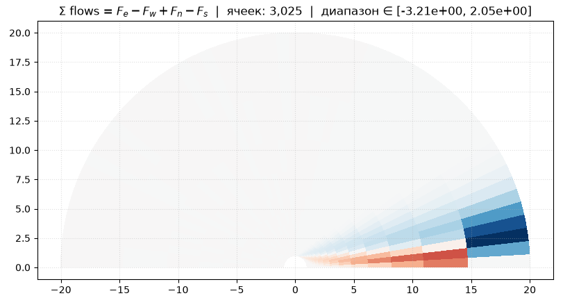

# Моделирование турбулентности вокруг шара

Текущиий прогресс: 
1) Подсчет компонент скорости
    - Z компонета вектора скорости
   
    - R компонента вектора скорости
   
    - Итоговая картина
   
2) Подсчет потоков

